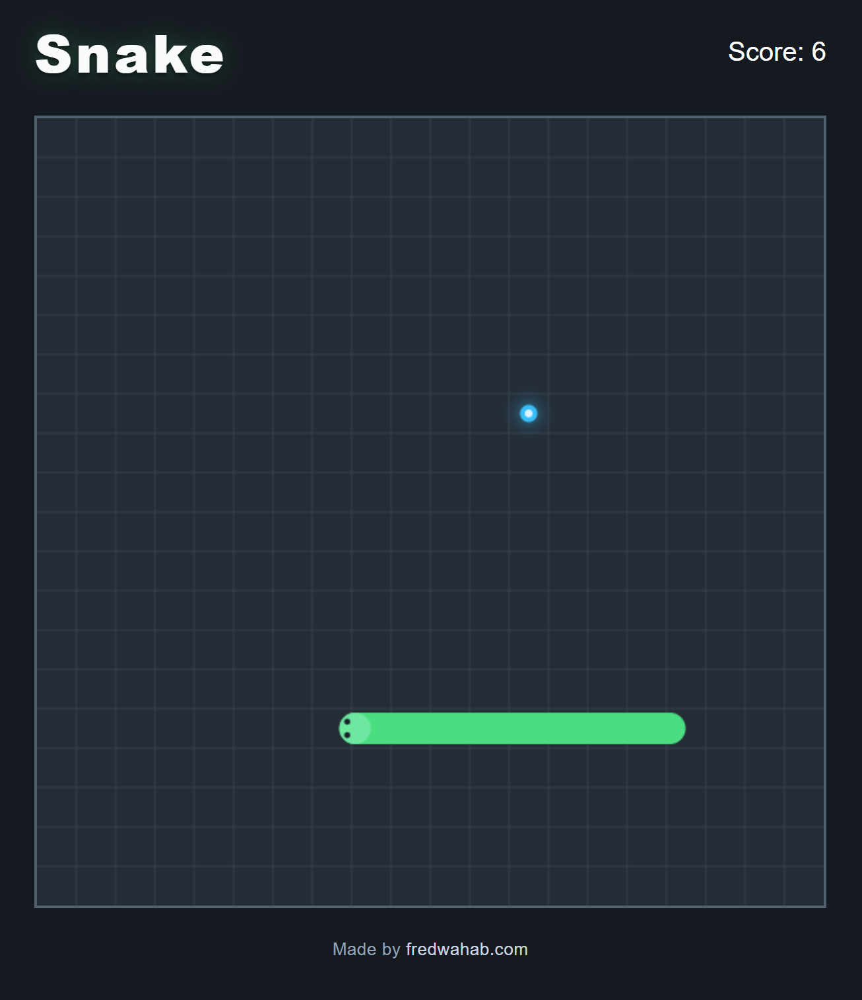

# Snake

A modern take on the classic Snake game, built with vanilla JavaScript and HTML5 Canvas.

Guide the snake around the board, collect food to increase your score, and grow as long as possible without colliding with the walls or your own body.

This version features smooth, continuous movement, rounded turns, animated growth, and responsive controls for both desktop and mobile devices.

**[Play Snake](https://fredwahab.github.io/Snake/)**



## How to Play

The objective is simple: eat food, grow longer, and survive.

- Collect the glowing blue food to earn points.
- Each piece of food increases your score and the snake's length.
- Avoid running into the walls or your own body.
- The game ends when a collision occurs.
- Fill the entire board to win!

### Desktop Controls

| Key | Action |
|---|---|
| Arrow Keys | Change direction |
| W / A / S / D | Change direction |
| Spacebar | Start, pause, resume, or restart |

The snake cannot reverse directly into itself.

### Mobile Controls

| Gesture | Action |
|---|---|
| Swipe Up | Move up |
| Swipe Down | Move down |
| Swipe Left | Move left |
| Swipe Right | Move right |
| Tap Board | Start, pause, resume, or restart |

The game is designed to work with touchscreen devices without requiring on-screen directional buttons.

## Features

- **Classic Snake Gameplay** — Collect food, increase your score, and avoid collisions.
- **Smooth Movement** — Continuous animation between grid positions rather than abrupt cell-by-cell movement.
- **Rounded Corners** — The snake follows a continuous route through turns.
- **Animated Growth** — The body extends naturally when food is collected.
- **Responsive Design** — A scalable game board for desktop and mobile screens.
- **Touchscreen Support** — Swipe-based movement and tap controls.
- **Pause and Resume** — Pause gameplay and continue when ready.
- **Collision Detection** — Handles wall collisions, self-collisions, and movement into cells vacated by the tail.
- **Random Food Placement** — Food spawns only in unoccupied cells.
- **Win and Game-Over States** — Clear feedback when the game ends.
- **No Gameplay Dependencies** — Built using standard browser APIs.

## Technologies Used

- **HTML5** — Page structure and canvas element
- **CSS3** — Responsive layout and visual styling
- **JavaScript (ES Modules)** — Game logic, animation, and input handling
- **Canvas 2D API** — Rendering the game board and animated objects
- **Vite** — Development server and production build tooling
- **GitHub Actions** — Automated build and deployment
- **GitHub Pages** — Static website hosting

## Project Structure

```text
Snake/
├── .github/
│   └── workflows/
│       └── deploy.yml
├── src/
│   ├── main.js
│   ├── game.js
│   ├── snake.js
│   ├── renderer.js
│   ├── input.js
│   └── style.css
├── index.html
├── package.json
├── vite.config.js
└── README.md
```

### JavaScript Modules

| File | Responsibility |
|---|---|
| `main.js` | Creates the interface and initializes the game |
| `game.js` | Manages game states, scoring, food spawning, and the game loop |
| `snake.js` | Handles movement, direction changes, collision detection, growth, and path history |
| `renderer.js` | Draws the board, food, and continuously animated snake |
| `input.js` | Handles keyboard and touchscreen controls |

This modular structure separates game rules from rendering and input handling, making the code easier to maintain and extend.

## Technical Implementation

### Grid-Based Game Logic

The game uses a 20 × 20 logical grid.

The snake is represented as an array of coordinate objects, with the first element representing the head.

Movement occurs at fixed intervals of 200 milliseconds. During each update, the game calculates the next head position, checks for collisions, and updates the snake's occupied cells.

This approach keeps collision detection and food placement predictable and independent of the rendering frame rate.

### Smooth Animation

Although the game logic operates on discrete grid coordinates, the visual animation uses `requestAnimationFrame()` to render intermediate positions.

The renderer calculates movement progress between logical updates, allowing the snake to appear to move continuously across the board.

This separates the game's simulation rate from its visual frame rate.

### Path-Based Snake Rendering

Rather than drawing each body segment as an independent moving object, the game maintains a history of positions traveled by the snake's head.

The renderer uses this history to construct a continuous path for the body.

Canvas strokes and quadratic curves create connected body sections and rounded corners.

This approach provides smooth movement around turns while preserving the underlying grid-based gameplay.

### Animated Growth

When the snake eats food, its logical length increases immediately.

The renderer handles the visual transition separately. During the growth movement, the tail remains stationary while the head continues forward.

This causes the snake to extend naturally instead of instantly displaying an additional full-length segment.

### Collision Detection

Collision checks occur before the snake's position is updated.

The game detects:

- Movement beyond the board boundaries
- Movement into an occupied body cell
- Legal movement into the tail's current cell when that tail is moving away

This preserves traditional Snake behavior while avoiding incorrect self-collisions.

### Input Handling

Keyboard and touchscreen input are processed through a dedicated input module.

Direction changes are queued and applied during logical movement updates.

Only one direction change is accepted per movement interval, preventing rapid inputs from producing invalid turns.

## Running Locally

### Prerequisites

- Node.js
- npm

### Installation

Clone the repository:

```bash
git clone https://github.com/fredwahab/Snake.git
```

Navigate to the project directory:

```bash
cd Snake
```

Install dependencies:

```bash
npm install
```

Start the development server:

```bash
npm run dev
```

Open the local URL displayed in your terminal.

### Production Build

Generate the optimized production files:

```bash
npm run build
```

The compiled application will be placed in the `dist/` directory.

To preview the production build locally:

```bash
npm run preview
```

## Deployment

Snake is hosted on GitHub Pages and deployed automatically using GitHub Actions.

When changes are pushed to the `main` branch, the deployment workflow:

1. Checks out the repository.
2. Installs Node.js and project dependencies.
3. Builds the application using Vite.
4. Uploads the production build.
5. Deploys the game to GitHub Pages.

The Vite configuration uses `/Snake/` as the production base path to ensure JavaScript and CSS assets load correctly from the repository's GitHub Pages URL.

**Live Game:** https://fredwahab.github.io/Snake/

## Future Improvements

The current version is fully playable. Potential future enhancements include:

- Additional visual effects and animation polish
- Further mobile layout refinements
- Optional sound effects
- Additional customization and presentation options

These are potential enhancements rather than requirements for the core game.

## About This Project

Snake is part of a collection of browser-based games developed to practice and demonstrate JavaScript programming, game development, and front-end engineering.

The project began as a traditional grid-based Snake implementation and evolved to include a modular architecture and a continuous path-based animation system.

Particular attention was given to separating gameplay logic from visual presentation, improving code organization, and supporting both desktop and touchscreen interaction.

The project demonstrates practical experience with:

- JavaScript ES modules
- HTML5 Canvas rendering
- Game loops and frame-based animation
- Collision detection and state management
- Responsive web design
- Touchscreen input handling
- Vite production builds
- Automated deployment with GitHub Actions

---

**Developed by [Fred Wahab](https://fredwahab.com)**

Part of my browser games portfolio.